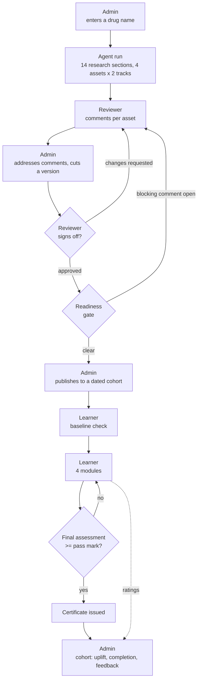

# User flows

One document per role. Each describes what the person does, what the system does in response, and what gets written to disk.

| Role | Document | Signs in as | Lands on |
| --- | --- | --- | --- |
| Admin | [admin.md](admin.md) | Priya Raman | `/dashboard` |
| Reviewer | [reviewer.md](reviewer.md) | Dr. Anil Shekhar, Dr. Maria Alvarez | `/dashboard` |
| MSL / HCP | [learner.md](learner.md) | Jordan Feld, Sara Nakamura / Dr. Ken Osei, Dr. Lucy Whitfield, Dr. Tom Becker | `/learn` |

## The loop across roles

A course only reaches a learner by passing through every gate. Nothing here can be skipped from the UI.

## Sign-in

Every flow starts at `/`. The login page lists the demo roster grouped by role; picking a person calls `POST /api/session` and stores the returned record in `localStorage` under `pharmalearn.session`. There are no passwords — this is a demo of the workflow, not of authentication.

`useSession(allowed)` guards each page: no session redirects to `/`, and a role outside `allowed` is sent to that role's own home. Admin and Reviewer share `/dashboard`; MSL and HCP share `/learn`.

## Where state lands

| Written by | Path |
| --- | --- |
| Agent run | `.pharmalearn/content/<run-id>/`, `.pharmalearn/logs/<run-id>/` |
| Review, versions, sign-offs, publication | `.pharmalearn/platform/courses/<run-id>.json` |
| A learner's modules, attempts, certificate, feedback | `.pharmalearn/platform/progress/<run-id>/<user-id>.json` |
| Roster (seeded on first read) | `.pharmalearn/platform/roster.json` |
| Staged documents and fetched pages | `.pharmalearn/uploads/<timestamp>/` |

Deleting `.pharmalearn/platform/` resets every flow below to a freshly generated, unreviewed course. The generated content itself is untouched by that.
